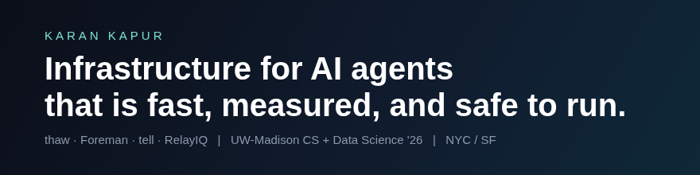

### Hi, I'm Karan

I build infrastructure that makes AI agents fast and safe to run.

- ❄️ Co-founded [thaw](https://github.com/karank2512/thaw): git for live LLM sessions. A session forks in 0.88s instead of a ~340s cold boot on H100s.
- ⚙️ Built [Foreman](https://github.com/karank2512/Foreman): an agentic workforce platform where every external action waits for human approval and every run is scored 3 ways.
- 📈 Built [tell](https://github.com/karank2512/tell-ai): explainable buying signals. 907 companies, 10,585 postings, 97.8% run success over 321 runs.
- 📊 Built [RelayIQ](https://github.com/karank2512/RelayIQ): an agentic decision engine that cut cost per usable lead 3.3x on a 495-case seeded benchmark.

🎓 UW-Madison CS + Data Science, May 2026 &nbsp;·&nbsp; Open to FDE, GTM, and founding engineer roles in NYC or SF

  

📫 kkapur5@wisc.edu · [karankapur.com](https://karankapur.com) · [LinkedIn](https://linkedin.com/in/karankapur5)
